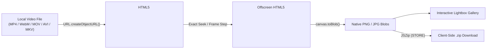

<div align="center">
  <a href="https://video-to-frames.github.io/">
    
  </a>

  <h1>Video to Frames</h1>
  <p><strong>Ultra-minimal, 100% client-side video frame extractor built with Astro Islands Architecture.</strong></p>
  <p>Extract native-resolution PNG &amp; JPG stills from MP4, WebM, MOV, AVI, and MKV videos directly in browser memory — zero server uploads, zero watermarks, 8 languages, and full offline PWA support.</p>

  <p>
    <a href="https://video-to-frames.github.io/">
      
    </a>
    <a href="https://github.com/video-to-frames/video-to-frames.github.io/actions/workflows/deploy.yml">
      
    </a>
    <a href="#privacy-first-architecture">
      
    </a>
    <a href="#offline-pwa-support">
      
    </a>
    <a href="#internationalization">
      
    </a>
    <a href="./LICENSE">
      
    </a>
  </p>

  <p>
    <a href="https://video-to-frames.github.io/">Live Demo</a>
    &nbsp;•&nbsp;
    <a href="#key-features">Features</a>
    &nbsp;•&nbsp;
    <a href="#architecture">Architecture</a>
    &nbsp;•&nbsp;
    <a href="#local-development">Local Setup</a>
    &nbsp;•&nbsp;
    <a href="#support-the-developer">Support Developer</a>
  </p>
</div>

---

## Table of Contents

- [Privacy-First Architecture](#privacy-first-architecture)
- [Key Features](#key-features)
- [Supported Formats & Keyboard Shortcuts](#supported-formats--keyboard-shortcuts)
- [Internationalization](#internationalization)
- [Offline PWA Support](#offline-pwa-support)
- [SEO & Accessibility Architecture](#seo--accessibility-architecture)
- [Tech Stack](#tech-stack)
- [Project Structure](#project-structure)
- [Local Development](#local-development)
- [Deployment](#deployment)
- [License](#license)
- [Support the Developer](#support-the-developer)

---

## Privacy-First Architecture

> **Video never leaves your device.**

**Video to Frames** is engineered as a pure static web application with no upload API, no backend transcoding queue, and no server-side media storage. Local video files are mounted directly from disk via `URL.createObjectURL()`, decoded natively by the browser's hardware media engine, rendered onto an offscreen HTML5 `<canvas>` at full source dimensions, and optionally bundled in RAM using `JSZip`.

<a id="architecture"></a>



---

## Key Features

### Above-the-Fold Interactive Workspace
- Immediate drag-and-drop and file picker access without scrolling on desktop, tablet, and mobile viewports.
- Ultra-minimal icon-only responsive navigation bar below `900px` for uncluttered mobile usability.
- Tactile high-contrast **Light Mode** (`#FCF8F8` / `#FBEFEF` / `#F5AFAF` / `#1E1B1B`) and **Dark Mode** (`#121010` / `#1C1818` / `#F5AFAF` / `#FCF8F8`) with zero-FOUC theme initialization.

### Two Precision Extraction Modes
1. **Mode 1 — Single Frame Capture**
   - Millisecond-accurate timestamp scrubber, `±1s` and `±1 Frame` stepping, direct seconds jump input, shutter flash feedback, and keyboard controls.
2. **Mode 2 — Auto Batch Sequence**
   - Sample frames **every N seconds** (`0.5s`, `1s`, `2s`, `5s`, `10s`, or custom interval) or at a custom **FPS** rate (`1`–`30+ fps`).
   - Optional **Start / End** clip trimming (with one-click `Use current` scrubber markers), live frame count estimation, animated progress bar, and instant `AbortController` cancellation that preserves already captured frames.

### Export & Gallery Inspection
- **Output Formats:** Lossless **PNG** or quality-adjustable **JPG** (`50%`–`100%`) exported at the source video's exact native pixel resolution.
- **Gallery & Lightbox:** Staggered entrance animations, full-resolution modal inspector with arrow-key navigation, individual frame downloads, and bulk **Download All as ZIP**.

---

## Supported Formats & Keyboard Shortcuts

### Container & Codec Support

| Format | Role in Browser Engine | Notes |
| :--- | :--- | :--- |
| **MP4** | H.264 / H.265 | Universal hardware decoding across desktop & mobile |
| **WebM** | VP8 / VP9 / AV1 | Fast keyframe seeking and transparent PNG support for alpha streams |
| **MOV** | Apple QuickTime | Native playback in Safari and modern Chromium browsers |
| **AVI** | Legacy Container | Supported when encoded with browser-compatible codecs |
| **MKV** | Matroska | Native playback in modern Chromium-based browsers |

### Keyboard Shortcuts (Single Frame Mode & Lightbox)

| Shortcut | Action |
| :--- | :--- |
| `Space` | Toggle Play / Pause |
| `←` / `→` | Step `-1 Frame` / `+1 Frame` (or navigate frames in Lightbox) |
| `Shift + ←` / `Shift + →` | Jump `-1s` / `+1s` |
| `C` | Capture current frame immediately |
| `Esc` | Close active modal, dropdown, or Lightbox and restore focus |

---

## Internationalization

All UI strings—including the interactive Preact island, static guides, breadcrumbs, navigation controls, and structured metadata—support **8 languages** with instant reactive switching (`localStorage`) and dedicated crawlable static routes:

| Locale | Language | Root URL | Alternate Route |
| :--- | :--- | :--- | :--- |
| `en` | English (`x-default`) | `/` | `/` |
| `es` | Español | `/es/` | `/es/how-it-works/`, `/es/privacy/`, `/es/faq/` |
| `pt` | Português | `/pt/` | `/pt/how-it-works/`, `/pt/privacy/`, `/pt/faq/` |
| `de` | Deutsch | `/de/` | `/de/how-it-works/`, `/de/privacy/`, `/de/faq/` |
| `fr` | Français | `/fr/` | `/fr/how-it-works/`, `/fr/privacy/`, `/fr/faq/` |
| `ja` | 日本語 | `/ja/` | `/ja/how-it-works/`, `/ja/privacy/`, `/ja/faq/` |
| `zh` | 简体中文 (`zh-Hans`) | `/zh/` | `/zh/how-it-works/`, `/zh/privacy/`, `/zh/faq/` |
| `ru` | Русский | `/ru/` | `/ru/how-it-works/`, `/ru/privacy/`, `/ru/faq/` |

Non-default client locale dictionaries are code-split via Vite dynamic imports in [`src/i18n/index.ts`](./src/i18n/index.ts), keeping initial runtime JavaScript minimal while precaching all split chunks for offline switching.

---

## Offline PWA Support

- **Web App Manifest:** [`public/manifest.webmanifest`](./public/manifest.webmanifest) configures `standalone` display, theme colors, and generated PNG icons (`192x192`, `512x512`, `maskable`, and `180x180` Apple touch icon).
- **Automated Build Precaching:** The custom `vtf-pwa-precache` integration inside [`astro.config.mjs`](./astro.config.mjs) scans `./dist` after every production build, computes a deterministic SHA-256 cache version, and injects every HTML route, hashed `/_astro/*` JS/CSS bundle (including `JSZip` and split locale chunks), and icon asset into `dist/sw.js`.
- **Add to Home Screen Trigger:** Captures `beforeinstallprompt` for one-click installation on supported browsers and displays tailored desktop/iOS install guidance when native prompts are unavailable.

---

## SEO & Accessibility Architecture

- **Astro Islands Architecture:** Static landing sections and secondary routes (`/how-it-works/`, `/privacy/`, `/faq/`) ship **zero hydrated islands**, reserving `client:load` exclusively for [`src/components/FrameExtractor.tsx`](./src/components/FrameExtractor.tsx).
- **Structured Data (JSON-LD):** Clean, content-aligned `WebApplication`, `HowTo`, `FAQPage`, `WebPage`, and `BreadcrumbList` schemas with zero synthetic `AggregateRating` or `Review` markup.
- **Dual Sitemap Configuration:** Emits both `@astrojs/sitemap` (`sitemap-index.xml` + `sitemap-0.xml` with `xhtml:link` alternates) and a direct flat [`public/sitemap.xml`](./public/sitemap.xml), both declared inside [`public/robots.txt`](./public/robots.txt) for seamless Google Search Console parsing.
- **WCAG 2.1 Accessibility:** AAA contrast across Light and Dark themes, skip-to-content link, visible semantic breadcrumbs, localized ARIA labels, `aria-live="polite"` status announcements, `tablist`/`tabpanel` keyboard wiring, and modal focus trapping with focus restoration.

---

## Tech Stack

| Layer | Technology |
| :--- | :--- |
| **Static Site & Islands** | [Astro](https://astro.build/) (`output: 'static'`, `trailingSlash: 'always'`) |
| **Interactive Island** | [Preact](https://preactjs.com/) (`@astrojs/preact`) + TypeScript (`strict`) |
| **Client Media & ZIP** | HTML5 `<video>`, Canvas 2D API, [JSZip](https://stuk.github.io/jszip/) |
| **Sitemaps & SEO** | `@astrojs/sitemap`, Flat XML Sitemap, JSON-LD, Open Graph, GTM / GA4 |
| **CI/CD & Hosting** | GitHub Actions (`actions/deploy-pages@v4`) + GitHub Pages (`public/.nojekyll`) |

---

## Project Structure

```text
.
├── .github/workflows/
│   └── deploy.yml                  # Automated GitHub Pages build & deploy workflow
├── public/
│   ├── icons/                      # PWA & Apple Touch PNG icons (180, 192, 512, maskable)
│   ├── .nojekyll                   # Preserves Astro's /_astro/ directory on GitHub Pages
│   ├── favicon.svg                 # Scalable vector brand mark
│   ├── manifest.webmanifest        # PWA manifest
│   ├── og-image.png                # 1200x630 Open Graph / Twitter social card
│   ├── robots.txt                  # Crawler rules + dual sitemap references
│   ├── sitemap.xml                 # Flat canonical XML sitemap for Google Search Console
│   └── sw.js                       # Offline-first Service Worker template
├── src/
│   ├── components/
│   │   ├── BrandIcon.astro         # Shared SVG brand emblem
│   │   ├── Breadcrumbs.astro       # Semantic breadcrumb navigation
│   │   ├── Footer.astro            # Localized footer with guide & project links
│   │   ├── FrameExtractor.tsx      # Hydrated Preact client-side extraction island
│   │   ├── Navbar.astro            # Responsive desktop + icon-only mobile navbar
│   │   └── PwaModal.astro          # Offline install instructions & status dialog
│   ├── i18n/
│   │   ├── locales/                # Strictly typed dictionaries (en, es, pt, de, fr, ja, zh, ru)
│   │   ├── index.ts                # Lazy-loading client i18n runtime
│   │   ├── languages.ts            # Locale metadata & OG locale mapping
│   │   ├── ssr.ts                  # Build-time synchronous translation helpers
│   │   └── types.ts                # Strict TranslationMap contract
│   ├── layouts/
│   │   └── BaseLayout.astro        # SEO meta, hreflang, GTM/GA4, zero-FOUC theme init, JSON-LD
│   ├── lib/
│   │   └── frame-extractor.ts      # Video seek, canvas capture, batch planner & JSZip engine
│   ├── pages/
│   │   ├── [lang]/                 # Pre-rendered localized static routes (es..ru)
│   │   ├── index.astro             # Root frame extractor workspace & landing sections
│   │   ├── how-it-works.astro      # Step-by-step extraction & shortcut guide
│   │   ├── privacy.astro           # Zero-upload architecture & storage policy
│   │   └── faq.astro               # Categorized FAQ accordion page
│   ├── scripts/
│   │   └── app-shell.ts            # Theme toggle, accessible dropdown, PWA modal & SW registration
│   ├── styles/
│   │   └── global.css              # Design tokens, responsive navbar, workspace & animations
│   └── views/                      # Shared page view templates for root & localized routes
├── astro.config.mjs                # Astro config, sitemap i18n, and PWA precache hook
├── LICENSE                         # MIT License
├── package.json
└── tsconfig.json
```

---

## Local Development

### Prerequisites

- **Node.js** `>= 22.23.4` (verified on `v24.19.0`)
- **npm** `>= 9.6.5`

### Quick Start

```bash
# 1. Clone the repository
git clone https://github.com/video-to-frames/video-to-frames.github.io.git
cd video-to-frames.github.io

# 2. Install dependencies
npm install

# 3. Start local development server (http://localhost:4321)
npm run dev
```

### Available Scripts

| Command | Description |
| :--- | :--- |
| `npm run dev` | Starts the Astro dev server with hot module reload |
| `npm run check` | Runs `astro check` TypeScript & `.astro` diagnostics |
| `npm run build` | Runs `astro check && astro build` and populates `dist/sw.js` precache URLs |
| `npm run preview` | Serves the production `./dist` build locally for inspection |

---

## Deployment

Every push to `main` triggers [`.github/workflows/deploy.yml`](./.github/workflows/deploy.yml), which:

1. Checks out the repository and caches npm dependencies on Node 24.
2. Runs `npm ci` and `npm run build` (`astro check && astro build`).
3. Uploads `./dist` (including `.nojekyll`, `sitemap.xml`, `sitemap-index.xml`, `sw.js`, and all 32 static pages) and deploys directly via `actions/deploy-pages@v4`.

---

## License

Released under the [MIT License](./LICENSE).

---

## Support the Developer

If **Video to Frames** helps your creative, engineering, or content workflow and you want to support free, privacy-first, open-source web tools:

[](https://kisharadilshan.gumroad.com/coffee)

- **Gumroad:** [https://kisharadilshan.gumroad.com/coffee](https://kisharadilshan.gumroad.com/coffee)
